# Assignment 3: Production-Ready MLOps AI Agent — Technical Report

MLOps & Production AI Engineering, Fall 2026. Repository: `FaranAzam1/assignment-03-mlops` (private).
Everything below was produced by running the system on Docker Desktop (Airflow 3.0.6, MLflow 3.18,
Kubernetes v1.36.1 single node) with a local Ollama model (`llama3.2:1b`). Transcripts are the files in
`report/evidence/`, written by `scripts/run_demo.py` and `scripts/ask.py`; they are not edited.

## 1. System architecture

```
User ─► CLI (agent/main.py) / FastAPI (api/main.py: /chat /confirm /reject /tools)
          │ pydantic validation
          ▼
   Orchestrator ── planner.py (deterministic workflows) ── llm.py (Ollama tool calling)
          │ permission gate: confirmation + approved namespace / DAG
          ▼  execute_tool(): JSON-schema check, timeout, 1 retry (read-only), error class, JSON log
 ┌──────────────┬────────────────┬──────────────────┬───────────────────┐
 │ DVC tools    │ MLflow tools   │ Airflow tools    │ Kubernetes tools  │
 │ git+dvc CLI  │ MlflowClient   │ Airflow 3 REST   │ kubernetes client │
 └──────────────┴────────────────┴──────────────────┴───────────────────┘
          ▼
   reporting.py → Known facts · Uncertainties · Recommended actions · Evidence
```

Runtime stack: `docker-compose.yml` runs MLflow (SQLite backend, proxied artifacts), Airflow 3 (standalone
with a **Postgres** metadata DB) and Postgres; the inference service runs in Kubernetes
(`kubernetes/`: Namespace, ConfigMap, Deployment with 2 replicas, readiness and liveness probes, CPU and
memory requests and limits, ClusterIP Service). Details and justifications: `architecture.md`.

**Key design decisions**

* **Evidence only.** The answer is built by `agent/reporting.py` from tool results. A failed tool becomes an
  *uncertainty* ("not verified; no value was assumed"), never a fact. Every answer lists the tool calls,
  statuses, durations and request id.
* **Hybrid orchestration.** The 1B local model selects tools for single-domain questions. Multi-technology
  questions run through a deterministic workflow (the best run's id feeds the DVC lookup, which feeds the
  retraining decision). State-changing requests also bypass the LLM's argument selection: during testing the
  model sent `namespace='namespace'`, which the namespace guard rejected. If the LLM is down, picks nothing or
  has all its calls rejected, the planner takes over (`mode: rules-fallback`).
* **Retraining is evidence-gated** (failed quality gate, best candidate never gated, training data differs from
  the current committed data, user-reported degradation flagged as unverified) and **never started
  automatically**.

## 2. Tool definitions and permissions

| Module | Tools | Mutates | Guard |
|---|---|---|---|
| DVC | `dvc_list_datasets`, `dvc_get_dataset_version`, `dvc_list_dataset_history`, `dvc_compare_dataset_versions`, `dvc_check_data_changed`, `dvc_explain_reproduce`, `dvc_get_run_dataset_provenance` | no | read-only `git`/`dvc` subcommand allow-list, `shell=False`, path cannot escape the repo |
| MLflow | `mlflow_list_experiments`, `mlflow_list_runs`, `mlflow_get_run_details`, `mlflow_find_best_run`, `mlflow_compare_runs`, `mlflow_compare_experiments`, `mlflow_get_model_registry` | no | `MlflowClient` only; best run is never labelled production-ready |
| Airflow | `airflow_list_dags`, `airflow_get_dag_runs`, `airflow_get_failed_tasks`, `airflow_get_task_diagnostics` | no | JWT from `/auth/token`, credentials from the environment |
| Airflow | `airflow_trigger_dag` | **yes** | approved DAG ids + explicit confirmation |
| Kubernetes | `k8s_list_pods`, `k8s_list_deployments`, `k8s_list_services`, `k8s_get_pod_logs`, `k8s_get_events`, `k8s_find_unhealthy_pods`, `k8s_get_deployed_version` | no | approved namespaces only |
| Kubernetes | `k8s_restart_deployment`, `k8s_scale_deployment` | **yes** | approved namespace + explicit confirmation |

The confirmation flag `_confirmed` is set only by `Agent.confirm()` after the user confirms a parked action;
keys starting with `_` in LLM arguments are discarded. Transcripts of the gate:

```text
USER: restart the kubernetes deployment

[request 164ad944e185 | mode workflow]

TOOL CALLS:
  - k8s_restart_deployment {'deployment': 'ml-inference'} -> pending (3 ms)

AGENT:
## Known facts (from tool output)
- None: every tool call failed or is awaiting confirmation.

## Uncertainties
- None identified.

... (5 more lines in report/evidence/safety_unconfirmed_restart.txt)
```

```text
USER: restart the kubernetes deployment in namespace kube-system

[request 9bbc2fbfb2a5 | mode workflow]

TOOL CALLS:
  - k8s_restart_deployment {'deployment': 'ml-inference', 'namespace': 'kube-system'} -> denied (3 ms)

AGENT:
## Known facts (from tool output)
- None: every tool call failed or is awaiting confirmation.

## Uncertainties
- k8s_restart_deployment denied: namespace 'kube-system' is not approved; allowed: ['mlops']. Not verified; no value was assumed.

... (5 more lines in report/evidence/safety_unapproved_namespace.txt)
```

Structured log (one JSON line per tool call; `password|token|secret|api_key|authorization` values and
`Bearer`/JWT strings are redacted, long strings truncated). Sample from `logs/agent.jsonl`:

```text
{"ts": "2026-11-15T13:25:23.175789+00:00", "event": "tool_call", "request_id": "1f4eb01faa98", "tool": "dvc_get_dataset_version", "status": "ok", "duration_ms": 169.3, "args": {}, "error": null}
{"ts": "2026-11-15T13:25:27.585208+00:00", "event": "tool_call", "request_id": "1f4eb01faa98", "tool": "k8s_get_deployed_version", "status": "ok", "duration_ms": 4408.8, "args": {}, "error": null}
{"ts": "2026-11-15T13:25:27.682622+00:00", "event": "tool_call", "request_id": "1f4eb01faa98", "tool": "k8s_find_unhealthy_pods", "status": "ok", "duration_ms": 96.6, "args": {}, "error": null}
{"ts": "2026-11-15T13:25:27.788625+00:00", "event": "tool_call", "request_id": "1f4eb01faa98", "tool": "airflow_get_dag_runs", "status": "ok", "duration_ms": 105.4, "args": {"dag_id": "training_pipeline", "limit": 5}, "error": null}
{"ts": "2026-11-15T13:25:29.518689+00:00", "event": "tool_call", "request_id": "164ad944e185", "tool": "k8s_restart_deployment", "status": "denied", "duration_ms": 2.8, "args": {"deployment": "ml-inference"}, "error": "restarting a Deployment requires explicit user confirmation"}
{"ts": "2026-11-15T13:25:30.593883+00:00", "event": "tool_call", "request_id": "9bbc2fbfb2a5", "tool": "k8s_restart_deployment", "status": "denied", "duration_ms": 3.2, "args": {"deployment": "ml-inference", "namespace": "kube-system"}, "error": "namespace 'kube-system' is not approved; allowed: ['mlops']"}
```

## 3. Evidence from the four technologies

**DVC** — two dataset versions, `data-v1` and `data-v2`, with the md5 recorded in Git and the data in the DVC remote.

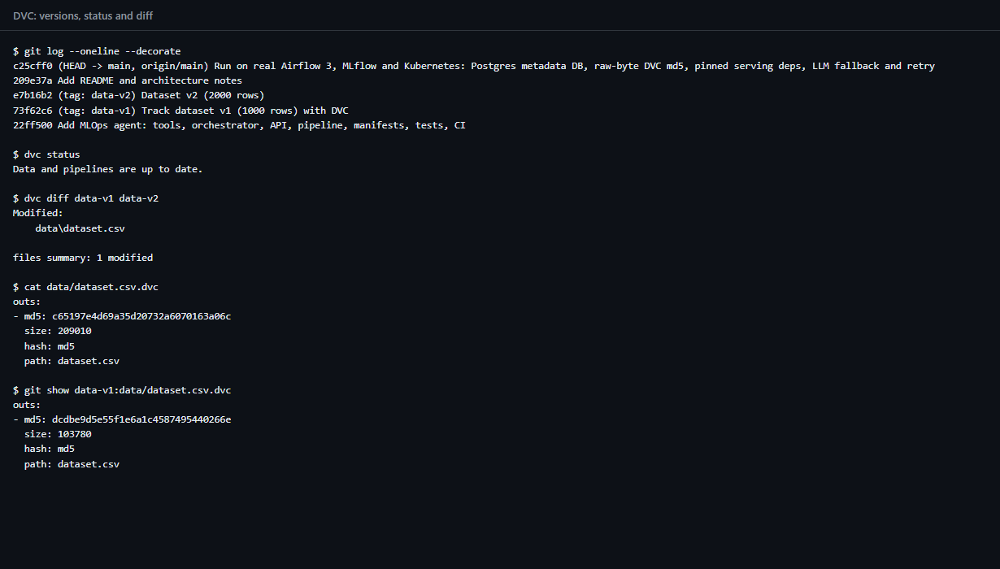

**MLflow** — runs produced by the Airflow DAG, each tagged with the DVC md5, the Git commit and the quality-gate result.

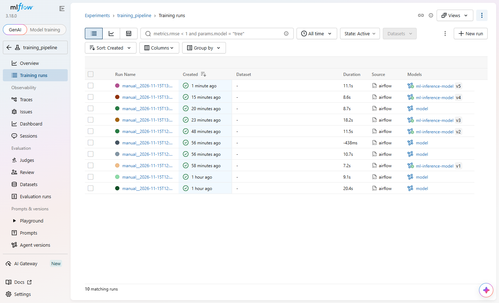
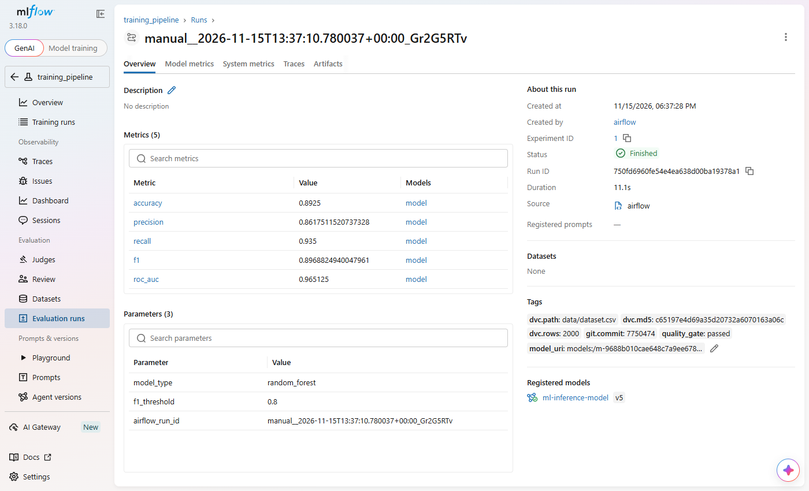
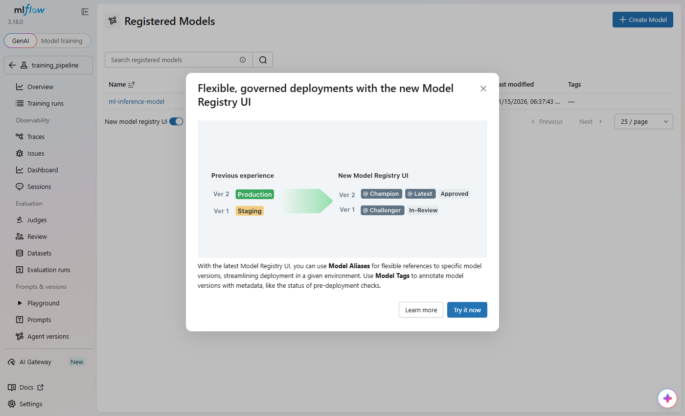

**Airflow 3** — the DAG `validate → preprocess → train → evaluate/log → quality gate`, real runs, a failed run's task log.

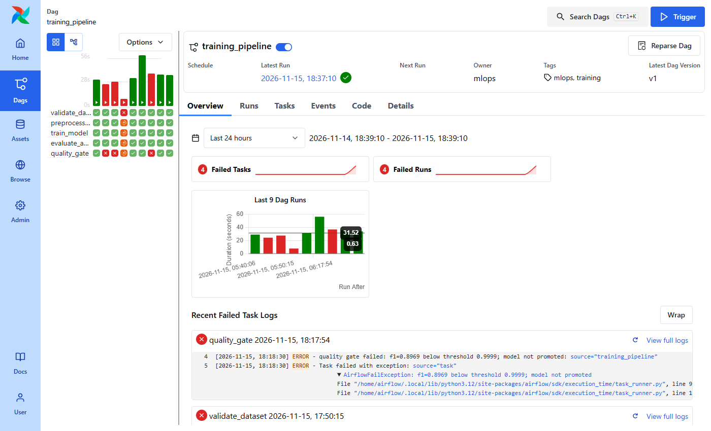
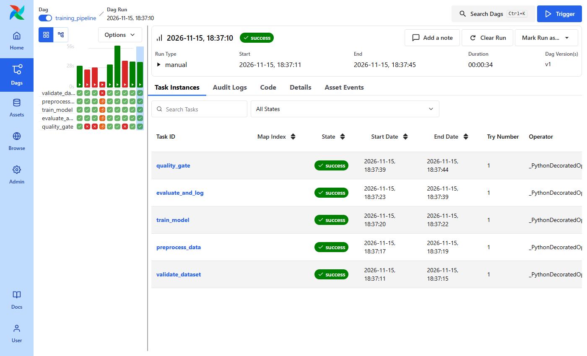
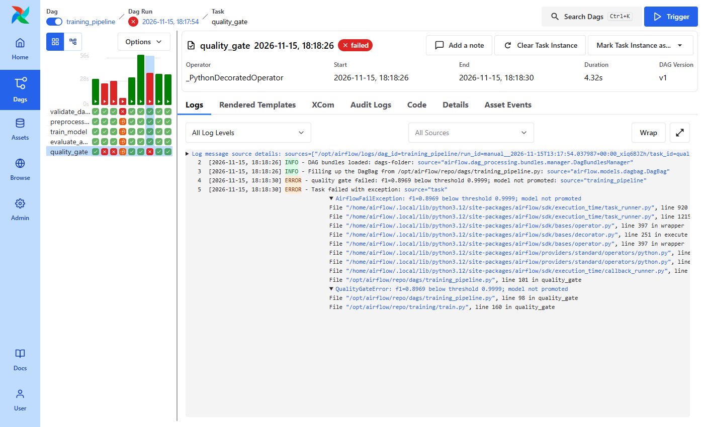

**Kubernetes** — the healthy deployment, then two injected faults.

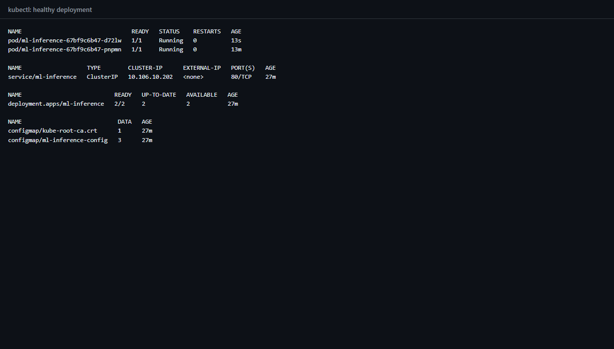
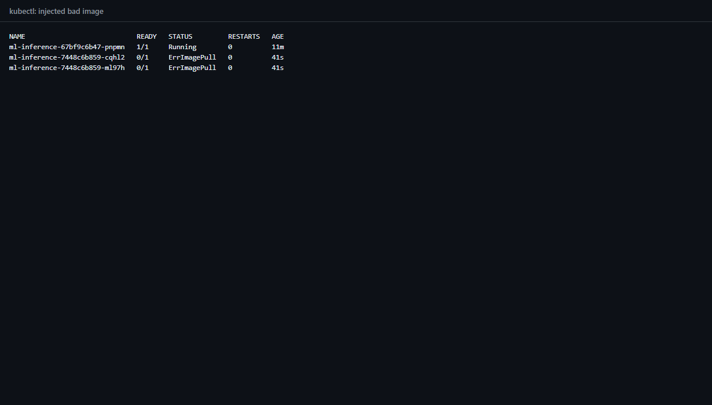
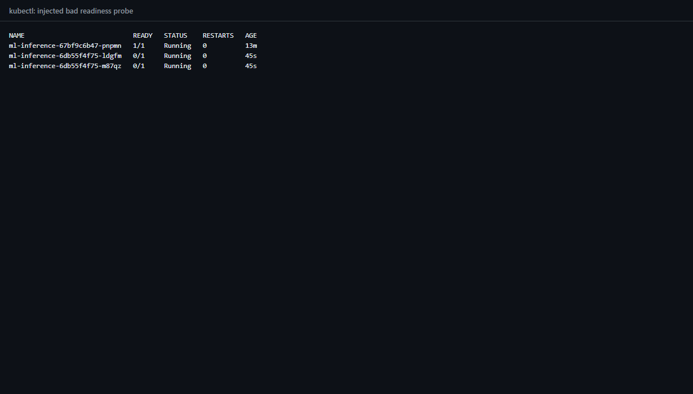

## 4. Five tested agent conversations (real tool evidence)

### 4.1 Dataset provenance

```text
USER: Which dataset version was used to train the best model run, and how can I reproduce it?

[request aaebc8b11c53 | mode workflow]

TOOL CALLS:
  - mlflow_find_best_run {'metric': 'f1', 'limit': 5} -> ok (4471 ms)
  - dvc_get_run_dataset_provenance {'run_id': '914d72d20f484b1093d6920c7539376e'} -> ok (155 ms)
  - dvc_get_dataset_version {} -> ok (151 ms)

AGENT:
## Known facts (from tool output)
- [mlflow_find_best_run] Best of 5 recent finished runs by f1: run 914d72d2 (accuracy=0.8925, f1=0.8969, precision=0.8618, recall=0.9350, roc_auc=0.9651); quality_gate tag: passed.
- [mlflow_find_best_run] Ranking: 914d72d2=0.8969, 51a71a31=0.8969, a82a36c9=0.8969, d5981fda=0.8969, ffb6a6e8=0.6650
- [dvc_get_run_dataset_provenance] Run 914d72d2 recorded dataset md5 c65197e4d69a35d20732a6070163a06c (rows: 2000); that data version is Git commit e7b16b2 / data-v2.
- [dvc_get_run_dataset_provenance] To reproduce: git checkout e7b16b2 -- data/dataset.csv.dvc && dvc checkout data/dataset.csv
- [dvc_get_dataset_version] Dataset dataset.csv: md5 c65197e4d69a35d20732a6070163a06c, last changed in commit e7b16b2 (data-v2); repo HEAD is c25cff0.

## Uncertainties
- Ranked only the 5 most recent finished runs, not all history.
- Selection used 'f1' alone; precision/recall trade-offs and data drift not assessed.
- Margin over the runner-up is only 0.0000: effectively a tie.

## Recommended actions
- None required.

## Evidence
- mlflow_find_best_run -> ok (4471 ms, request aaebc8b11c53)
- dvc_get_run_dataset_provenance -> ok (155 ms, request aaebc8b11c53)
- dvc_get_dataset_version -> ok (151 ms, request aaebc8b11c53)
```

### 4.2 Model selection

```text
USER: Compare the last five training runs and recommend the best candidate based on F1 score.

[request 1a015118228b | mode rules-fallback]

TOOL CALLS:
  - mlflow_list_runs {'limit': 5} -> ok (142 ms)
  - mlflow_find_best_run {'metric': 'f1', 'limit': 5} -> ok (176 ms)

AGENT:
## Known facts (from tool output)
- [mlflow_list_runs] 914d72d2 FINISHED 2026-11-15T12:50:30+00:00 accuracy=0.8925, f1=0.8969, precision=0.8618, recall=0.9350, roc_auc=0.9651 gate=passed
- [mlflow_list_runs] 51a71a31 FINISHED 2026-11-15T12:42:11+00:00 accuracy=0.8925, f1=0.8969, precision=0.8618, recall=0.9350, roc_auc=0.9651 gate=failed
- [mlflow_list_runs] ffb6a6e8 FINISHED 2026-11-15T12:42:04+00:00 accuracy=0.6675, f1=0.6650, precision=0.6701, recall=0.6600, roc_auc=0.7239 gate=failed
- [mlflow_list_runs] a82a36c9 FINISHED 2026-11-15T12:40:23+00:00 accuracy=0.8925, f1=0.8969, precision=0.8618, recall=0.9350, roc_auc=0.9651 gate=passed
- [mlflow_list_runs] d5981fda FINISHED 2026-11-15T12:36:37+00:00 accuracy=0.8925, f1=0.8969, precision=0.8618, recall=0.9350, roc_auc=0.9651 gate=pending
- [mlflow_find_best_run] Best of 5 recent finished runs by f1: run 914d72d2 (accuracy=0.8925, f1=0.8969, precision=0.8618, recall=0.9350, roc_auc=0.9651); quality_gate tag: passed.
- [mlflow_find_best_run] Ranking: 914d72d2=0.8969, 51a71a31=0.8969, a82a36c9=0.8969, d5981fda=0.8969, ffb6a6e8=0.6650

## Uncertainties
- Ranked only the 5 most recent finished runs, not all history.
- Selection used 'f1' alone; precision/recall trade-offs and data drift not assessed.
- Margin over the runner-up is only 0.0000: effectively a tie.

## Recommended actions
- None required.

... (3 more lines in report/evidence/scenario_2_model_selection.txt)
```

### 4.3 Pipeline execution (confirmation, then the real DAG run status)

```text
USER: Trigger the model training pipeline and report whether execution succeeded.

[request e597c710e3b7 | mode rules-fallback]

TOOL CALLS:
  - airflow_trigger_dag {'dag_id': 'training_pipeline'} -> pending (4 ms)

AGENT:
## Known facts (from tool output)
- None: every tool call failed or is awaiting confirmation.

## Uncertainties
- None identified.

## Recommended actions
- CONFIRMATION REQUIRED to run airflow_trigger_dag({'dag_id': 'training_pipeline'}): awaiting confirmation (action_id=58faa8c8)

## Evidence
- airflow_trigger_dag -> pending (4 ms, request e597c710e3b7)

USER CONFIRMED -> ## Known facts (from tool output)
- [airflow_trigger_dag] Triggered DAG run manual__2026-11-15T13:14:22.515495+00:00_Pquni63q (state queued).

## Uncertainties
- None identified.

## Recommended actions
- None required.

## Evidence
- airflow_trigger_dag -> ok (360 ms, request be832abccfea)

USER: What is the status of the latest airflow training pipeline runs?

[request 7b1c88ce2b1c | mode rules-fallback]

TOOL CALLS:
  - airflow_get_dag_runs {'dag_id': 'training_pipeline', 'limit': 5} -> ok (399 ms)

AGENT:
## Known facts (from tool output)
- [airflow_get_dag_runs] training_pipeline run manual__2026-11-15T13:14:22.515495+00:00_Pquni63q: success (start 2026-11-15T13:14:23.760123Z)
- [airflow_get_dag_runs] training_pipeline run manual__2026-11-15T12:50:16.857698+00:00_KgTDcYIY: success (start 2026-11-15T12:50:17.262603Z)
- [airflow_get_dag_runs] training_pipeline run manual__2026-11-15T12:50:15.773088+00:00_VJlYpy3U: failed (start 2026-11-15T12:50:16.599010Z)
- [airflow_get_dag_runs] training_pipeline run manual__2026-11-15T12:41:47.171635+00:00_uNWu9Kzu: failed (start 2026-11-15T12:41:47.833857Z)
- [airflow_get_dag_runs] training_pipeline run manual__2026-11-15T12:41:46.108447+00:00_r2tHJCfA: failed (start 2026-11-15T12:41:46.687085Z)

## Uncertainties
- None identified.

## Recommended actions
- None required.

## Evidence
- airflow_get_dag_runs -> ok (399 ms, request 7b1c88ce2b1c)
```

### 4.4 Deployment diagnosis

```text
USER: Why is my prediction API unavailable?

[request b853bf1ad10c | mode rules-fallback]

TOOL CALLS:
  - k8s_find_unhealthy_pods {} -> ok (1693 ms)
  - k8s_list_deployments {} -> ok (35 ms)
  - k8s_list_services {} -> ok (31 ms)
  - k8s_list_pods {} -> ok (24 ms)
  - k8s_get_pod_logs {'pod': 'ml-inference-67bf9c6b47-d72lw'} -> ok (72 ms)
  - k8s_get_deployed_version {} -> ok (34 ms)

AGENT:
## Known facts (from tool output)
- [k8s_find_unhealthy_pods] All Pods in the namespace look healthy.
- [k8s_list_deployments] ml-inference: 2/2 ready, images ['ml-inference:1.0.0']
- [k8s_list_services] ml-inference ClusterIP 10.106.10.202 ports [{'port': 80, 'target_port': '8000', 'protocol': 'TCP'}] selector {'app': 'ml-inference'}
- [k8s_list_pods] ml-inference-67bf9c6b47-d72lw phase=Running ready=True restarts=0
- [k8s_list_pods] ml-inference-67bf9c6b47-pnpmn phase=Running ready=True restarts=0
- [k8s_get_pod_logs] Logs of ml-inference-67bf9c6b47-d72lw:
- [k8s_get_pod_logs]   INFO:     10.1.0.1:60790 - "GET /ready HTTP/1.1" 200 OK
- [k8s_get_pod_logs]   INFO:     10.1.0.1:45968 - "GET /ready HTTP/1.1" 200 OK
- [k8s_get_pod_logs]   INFO:     10.1.0.1:45970 - "GET /health HTTP/1.1" 200 OK
- [k8s_get_pod_logs]   INFO:     10.1.0.1:45984 - "GET /ready HTTP/1.1" 200 OK
- [k8s_get_pod_logs]   INFO:     10.1.0.1:50236 - "GET /ready HTTP/1.1" 200 OK
- [k8s_get_pod_logs]   INFO:     10.1.0.1:50240 - "GET /health HTTP/1.1" 200 OK
- [k8s_get_pod_logs]   INFO:     10.1.0.1:50242 - "GET /ready HTTP/1.1" 200 OK
- [k8s_get_pod_logs]   INFO:     10.1.0.1:39270 - "GET /ready HTTP/1.1" 200 OK
- [k8s_get_deployed_version] Deployment ml-inference: image(s) ['ml-inference:1.0.0'], ready 2/2, rollout complete: True, MODEL_VERSION=1.0.0, version label=1.0.0.

## Uncertainties
- None identified.

## Recommended actions
... (9 more lines in report/evidence/scenario_4_deployment_diagnosis.txt)
```

### 4.5 Multi-tool reasoning (MLflow + DVC + Kubernetes + Airflow)

```text
USER: Find the best recent model, identify the dataset version used to train it, check the deployment status, and explain whether retraining is necessary.

[request 1f4eb01faa98 | mode workflow]

TOOL CALLS:
  - mlflow_find_best_run {'metric': 'f1', 'limit': 5} -> ok (12638 ms)
  - dvc_get_run_dataset_provenance {'run_id': '3f244438a7f941388df3292e28a60fe4'} -> ok (174 ms)
  - dvc_get_dataset_version {} -> ok (169 ms)
  - k8s_get_deployed_version {} -> ok (4409 ms)
  - k8s_find_unhealthy_pods {} -> ok (97 ms)
  - airflow_get_dag_runs {'dag_id': 'training_pipeline', 'limit': 5} -> ok (105 ms)

AGENT:
## Known facts (from tool output)
- [mlflow_find_best_run] Best of 5 recent finished runs by f1: run 3f244438 (accuracy=0.8925, f1=0.8969, precision=0.8618, recall=0.9350, roc_auc=0.9651); quality_gate tag: passed.
- [mlflow_find_best_run] Ranking: 3f244438=0.8969, fcfad04b=0.8969, 914d72d2=0.8969, d739ddb8=0.8969, 51a71a31=0.8969
- [dvc_get_run_dataset_provenance] Run 3f244438 recorded dataset md5 c65197e4d69a35d20732a6070163a06c (rows: 2000); that data version is Git commit e7b16b2 / data-v2.
- [dvc_get_run_dataset_provenance] To reproduce: git checkout e7b16b2 -- data/dataset.csv.dvc && dvc checkout data/dataset.csv
- [dvc_get_dataset_version] Dataset dataset.csv: md5 c65197e4d69a35d20732a6070163a06c, last changed in commit e7b16b2 (data-v2); repo HEAD is c25cff0.
- [k8s_get_deployed_version] Deployment ml-inference: image(s) ['ml-inference:1.0.0'], ready 2/2, rollout complete: True, MODEL_VERSION=1.0.0, version label=1.0.0.
- [k8s_find_unhealthy_pods] All Pods in the namespace look healthy.
- [airflow_get_dag_runs] training_pipeline run manual__2026-11-15T13:23:31.571609+00:00_wPtWgniz: success (start 2026-11-15T13:23:31.817928Z)
- [airflow_get_dag_runs] training_pipeline run manual__2026-11-15T13:17:54.037987+00:00_xiq6BJZh: failed (start 2026-11-15T13:17:54.806286Z)
- [airflow_get_dag_runs] training_pipeline run manual__2026-11-15T13:14:22.515495+00:00_Pquni63q: success (start 2026-11-15T13:14:23.760123Z)
- [airflow_get_dag_runs] training_pipeline run manual__2026-11-15T12:50:16.857698+00:00_KgTDcYIY: success (start 2026-11-15T12:50:17.262603Z)
- [airflow_get_dag_runs] training_pipeline run manual__2026-11-15T12:50:15.773088+00:00_VJlYpy3U: failed (start 2026-11-15T12:50:16.599010Z)

## Uncertainties
- Ranked only the 5 most recent finished runs, not all history.
- Selection used 'f1' alone; precision/recall trade-offs and data drift not assessed.
- Margin over the runner-up is only 0.0000: effectively a tie.
- No model-freshness policy is configured, so model age alone is not evidence.

## Recommended actions
- Retraining is NOT recommended on current evidence (no failed quality gate, data change or reported degradation found).

## Evidence
- mlflow_find_best_run -> ok (12638 ms, request 1f4eb01faa98)
- dvc_get_run_dataset_provenance -> ok (174 ms, request 1f4eb01faa98)
- dvc_get_dataset_version -> ok (169 ms, request 1f4eb01faa98)
- k8s_get_deployed_version -> ok (4409 ms, request 1f4eb01faa98)
- k8s_find_unhealthy_pods -> ok (97 ms, request 1f4eb01faa98)
- airflow_get_dag_runs -> ok (105 ms, request 1f4eb01faa98)
```

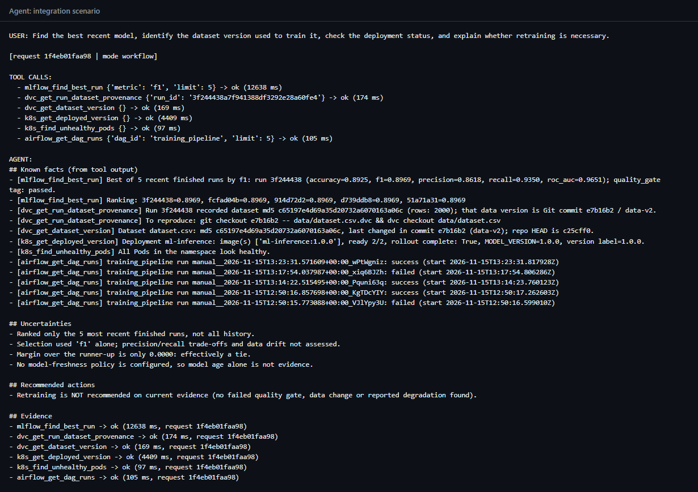

The agent separates known facts (tool output), uncertainties (tie between runs, single metric, no freshness
policy) and the recommendation. It did **not** recommend retraining because no failed gate, data change or
degradation report exists, and it never triggered the pipeline.

## 5. Failure investigations

### 5.1 Real failure: Kubernetes CrashLoopBackOff

*Symptom.* After `kubectl apply`, both Pods sat in `CrashLoopBackOff`, `0/2` ready. Asked "Why is my prediction
API unavailable?", the agent gathered Pod status, events, deployment, service and logs:

```text
**Summary (LLM, derived from the evidence below)**
The tool output indicates that the prediction API is currently unavailable. The "unhealthy_count" in the API's data shows that there are 2 unhealthy pods, which are experiencing issues with their readiness and liveness probes. The "error" in the API's data could not be verified. Additionally, the "warning_events" show 10 warnings, including 3 unhealthy pods, 3 back-off warnings, and 6 unhealthy service warnings.

## Known facts (from tool output)
- [k8s_find_unhealthy_pods] Unhealthy Pod ml-inference-649b79dccc-cdlcv: api: CrashLoopBackOff (phase Running, restarts 5).
- [k8s_find_unhealthy_pods] Unhealthy Pod ml-inference-649b79dccc-cjp2t: api: CrashLoopBackOff (phase Running, restarts 5).
- [k8s_find_unhealthy_pods] Event BackOff on ml-inference-649b79dccc-cdlcv: Back-off restarting failed container api in pod ml-inference-649b79dccc-cdlcv_mlops(0e930c81-5c3f-440c-8bb0-907315978bf0)
- [k8s_find_unhealthy_pods] Event Unhealthy on ml-inference-649b79dccc-cdlcv: Readiness probe failed: Get "http://10.1.0.10:8000/ready": dial tcp 10.1.0.10:8000: connect: connection refused
- [k8s_find_unhealthy_pods] Event BackOff on ml-inference-649b79dccc-cjp2t: Back-off restarting failed container api in pod ml-inference-649b79dccc-cjp2t_mlops(b68d6e57-65f3-4ca1-bc23-b82674d936ed)
- [k8s_find_unhealthy_pods] Event Unhealthy on ml-inference-649b79dccc-cjp2t: Readiness probe failed: Get "http://10.1.0.11:8000/ready": dial tcp 10.1.0.11:8000: connect: connection refused
- [k8s_list_deployments] ml-inference: 0/2 ready, images ['ml-inference:1.0.0']
- [k8s_list_services] ml-inference ClusterIP 10.106.10.202 ports [{'port': 80, 'target_port': '8000', 'protocol': 'TCP'}] selector {'app': 'ml-inference'}
- [k8s_get_pod_logs] Logs of ml-inference-649b79dccc-cdlcv:
- [k8s_get_pod_logs]     File "/usr/local/lib/python3.12/pickle.py", line 1581, in load_stack_global
- [k8s_get_pod_logs]       self.append(self.find_class(module, name))
- [k8s_get_pod_logs]                   ^^^^^^^^^^^^^^^^^^^^^^^^^^^^^
- [k8s_get_pod_logs]     File "/usr/local/lib/python3.12/pickle.py", line 1622, in find_class
- [k8s_get_pod_logs]       __import__(module, level=0)
- [k8s_get_pod_logs]   ModuleNotFoundError: No module named 'dill'
- [k8s_get_pod_logs]   
- [k8s_get_pod_logs]   ERROR:    Application startup failed. Exiting.
- [k8s_get_deployed_version] Deployment ml-inference: image(s) ['ml-inference:1.0.0'], ready 0/2, rollout complete: False, MODEL_VERSION=1.0.0, version label=1.0.0.

## Uncertainties
- None identified.

## Recommended actions
- Deployment rollout is not complete: inspect Pod events and logs before anything else.
- Fix the unhealthy Pods (see events/logs above). Retraining will not repair an infrastructure fault.

## Evidence
- k8s_find_unhealthy_pods -> ok (4076 ms, request 42fd4092854e)
- k8s_list_deployments -> ok (34 ms, request 42fd4092854e)
- k8s_list_services -> ok (26 ms, request 42fd4092854e)
... (4 more lines in report/evidence/failure_k8s_crashloop.txt)
```

*Root cause.* The model bundle was pickled inside the Airflow image, where numpy scalars are pickled through
`dill`. The serving image did not have `dill`, so `joblib.load` raised `ModuleNotFoundError: No module named 'dill'`
during startup and the container exited (readiness probe: connection refused).
*Resolution.* The serving image now pins the training environment: `scikit-learn==1.7.1`, `numpy==1.26.4`,
`joblib==1.5.1`, `dill==0.3.1.1` (`Dockerfile`). After a rollout restart both Pods are `1/1 Ready` and
`/predict` answers. *Lesson:* train and serve with identical library versions.

### 5.2 Injected failure: quality gate

Triggered the DAG with `{"f1_threshold": 0.9999}`. Everything up to evaluation succeeded; the gate blocked
promotion (run tagged `failed`, nothing registered or exported). The agent's diagnosis:

```text
USER: Why did the last failed airflow pipeline run fail?

[request 27eef8f8a46b | mode rules-fallback]

TOOL CALLS:
  - airflow_get_dag_runs {'dag_id': 'training_pipeline', 'limit': 5} -> ok (87 ms)
  - airflow_get_failed_tasks {'dag_id': 'training_pipeline'} -> ok (1378 ms)
  - airflow_get_task_diagnostics {'task_id': 'quality_gate', 'dag_run_id': 'manual__2026-11-15T13:17:54.037987+00:00_xiq6BJZh', 'dag_id': 'training_pipeline'} -> ok (127 ms)

AGENT:
## Known facts (from tool output)
- [airflow_get_dag_runs] training_pipeline run manual__2026-11-15T13:17:54.037987+00:00_xiq6BJZh: failed (start 2026-11-15T13:17:54.806286Z)
- [airflow_get_dag_runs] training_pipeline run manual__2026-11-15T13:14:22.515495+00:00_Pquni63q: success (start 2026-11-15T13:14:23.760123Z)
- [airflow_get_dag_runs] training_pipeline run manual__2026-11-15T12:50:16.857698+00:00_KgTDcYIY: success (start 2026-11-15T12:50:17.262603Z)
- [airflow_get_dag_runs] training_pipeline run manual__2026-11-15T12:50:15.773088+00:00_VJlYpy3U: failed (start 2026-11-15T12:50:16.599010Z)
- [airflow_get_dag_runs] training_pipeline run manual__2026-11-15T12:41:47.171635+00:00_uNWu9Kzu: failed (start 2026-11-15T12:41:47.833857Z)
- [airflow_get_failed_tasks] Run manual__2026-11-15T13:17:54.037987+00:00_xiq6BJZh failed tasks: quality_gate=failed.
- [airflow_get_failed_tasks] Task states: {'validate_dataset': 'success', 'preprocess_data': 'success', 'train_model': 'success', 'evaluate_and_log': 'success', 'quality_gate': 'failed'}
- [airflow_get_task_diagnostics] Task quality_gate state=failed try 1/0.
- [airflow_get_task_diagnostics]   log: ERROR quality gate failed: f1=0.8969 below threshold 0.9999; model not promoted
- [airflow_get_task_diagnostics]   log: AirflowFailException: f1=0.8969 below threshold 0.9999; model not promoted
- [airflow_get_task_diagnostics]   log: QualityGateError: f1=0.8969 below threshold 0.9999; model not promoted
- [airflow_get_task_diagnostics]   log: ERROR Task failed with exception -> AirflowFailException: f1=0.8969 below threshold 0.9999; model not promoted -> QualityGateError: f1=0.8969 below threshold 0.9999; model not promoted

## Uncertainties
- None identified.

## Recommended actions
- None required.

... (4 more lines in report/evidence/failure_airflow_quality_gate.txt)
```

### 5.3 Further injected failures

* **Validation:** conf `{"inject_failure": "validation"}` — `validate_dataset=failed`, the other four tasks
  `upstream_failed`; agent output in `report/evidence/failure_airflow_validation.txt`.
* **Bad image tag** (`scripts/inject_k8s_failure.py bad-image`) — the agent reported `ImagePullBackOff`, the
  event `Failed to pull image "ml-inference:9.9.9"` and `1/2` ready (the old Pod kept serving):
  `report/evidence/failure_k8s_bad_image.txt`.
* **Bad readiness probe** (`bad-probe`) — Pods `Running` but never Ready, event `Readiness probe failed: HTTP probe
  failed with statuscode: 404`: `report/evidence/failure_k8s_bad_probe.txt`.

### 5.4 Unexpected failures found while building (and fixed)

| # | Symptom | Root cause | Fix |
|---|---|---|---|
| 1 | First real DAG run: `validate_dataset` failed, `dataset md5 8aa1… does not match DVC-recorded c651…` (found with `airflow_get_task_diagnostics`) | My md5 helper normalised CRLF line endings; DVC 3 (`hash: md5`) hashes the raw bytes | `dvc_md5` hashes raw bytes; regression test |
| 2 | `quality_gate` always `failed` in about 1 s with an empty task log | Airflow 3.0.6 + SQLite metadata DB race: `409 invalid_state … previous_state: scheduled`, executor `uhoh` (scheduler container log) | Postgres metadata DB in `docker-compose.yml` |
| 3 | Agent blamed the quality gate for a run that died at `validate_dataset` | The retraining rule counted `upstream_failed` tasks as failed | Only `state == failed` tasks count; regression test |
| 4 | Task diagnostics showed only `::group::` markers | Airflow 3 returns structured log events (`error_detail`), not strings | Parser extracts `exc_type: exc_value`; test |
| 5 | LLM sent `deployment='deployment', namespace='namespace'` for a restart | 1B model invents arguments | Mutating requests bypass LLM arguments; the namespace guard also rejected it |
| 6 | MLflow `git.commit: unknown` | The Airflow image has no `git` binary | Read `.git/HEAD` as fallback |

## 6. Testing

`pytest`: 76 automated tests, all external systems mocked (CI does not need Docker, a cluster or Ollama):
tool selection and execution with a scripted LLM; argument validation; timeouts; connection failures and
the retry rule; a test proving the agent invents nothing when every service is down; rejection of Kubernetes
changes without confirmation, in an unapproved namespace and with an LLM-injected confirmation flag; structured
log content and secret redaction; DVC tools against a real throw-away Git repo; end-to-end training runs against
a temporary MLflow store (gate pass registers and exports; gate failure registers nothing); the FastAPI interface.
GitHub Actions runs `ruff` and `pytest` on every pull request and push to `main`.

## 7. Known limitations and proposed improvements

* The 1B model cannot plan multi-tool chains or write faithful prose (its optional summary misstated correct
  evidence, so it is off by default). Improvement: a larger tool-capable model, or a structured-output planner.
* Deterministic runs give identical F1, so "best run" is a tie; a real comparison needs seeds, cross-validation
  and a held-out set, and the agent only ranks the last N runs.
* DVC remote is a local folder; use object storage for a team. The DVC md5 detection relies on `dvc status`.
* Airflow runs in standalone mode (one container, LocalExecutor); production would use separate components.
* Kubernetes single node; no HPA, ingress, NetworkPolicy or secrets manager; the demo model image is built locally.
* Confirmation state lives in process memory (pending actions are lost on restart; no expiry or per-user identity).
* No authentication on the agent API; it must sit behind an authenticating proxy.
* Task logs are only as informative as the DAG's own logging; scheduler-level faults (failure 2 above) are not
  visible through the task-log API, so the agent cannot diagnose them. Improvement: add a scheduler-log tool.
