# Assignment 3: Production-Ready MLOps AI Agent — Technical Report

MLOps & Production AI Engineering, Fall 2026. Repository: `FaranAzam1/assignment-03-mlops` (private).
Everything below was produced by running the system on Docker Desktop (Airflow 3.0.6, MLflow 3.18,
Kubernetes v1.36.1 single node) with a local Ollama model (`llama3.2:1b`). Transcripts are the files in
`report/evidence/`, written by `scripts/run_demo.py` and `scripts/ask.py`; they are not edited.

## 1. System architecture

```
User ─► CLI (agent/main.py) / FastAPI (api/main.py: /chat /confirm /reject /tools)
          │ pydantic validation
          ▼
   Orchestrator ── planner.py (deterministic workflows) ── llm.py (Ollama tool calling)
          │ permission gate: confirmation + approved namespace / DAG
          ▼  execute_tool(): JSON-schema check, timeout, 1 retry (read-only), error class, JSON log
 ┌──────────────┬────────────────┬──────────────────┬───────────────────┐
 │ DVC tools    │ MLflow tools   │ Airflow tools    │ Kubernetes tools  │
 │ git+dvc CLI  │ MlflowClient   │ Airflow 3 REST   │ kubernetes client │
 └──────────────┴────────────────┴──────────────────┴───────────────────┘
          ▼
   reporting.py → Known facts · Uncertainties · Recommended actions · Evidence
```

Runtime stack: `docker-compose.yml` runs MLflow (SQLite backend, proxied artifacts), Airflow 3 (standalone
with a **Postgres** metadata DB) and Postgres; the inference service runs in Kubernetes
(`kubernetes/`: Namespace, ConfigMap, Deployment with 2 replicas, readiness and liveness probes, CPU and
memory requests and limits, ClusterIP Service). Details and justifications: `architecture.md`.

**Key design decisions**

* **Evidence only.** The answer is built by `agent/reporting.py` from tool results. A failed tool becomes an
  *uncertainty* ("not verified; no value was assumed"), never a fact. Every answer lists the tool calls,
  statuses, durations and request id.
* **Hybrid orchestration.** The 1B local model selects tools for single-domain questions. Multi-technology
  questions run through a deterministic workflow (the best run's id feeds the DVC lookup, which feeds the
  retraining decision). State-changing requests also bypass the LLM's argument selection: during testing the
  model sent `namespace='namespace'`, which the namespace guard rejected. If the LLM is down, picks nothing or
  has all its calls rejected, the planner takes over (`mode: rules-fallback`).
* **Retraining is evidence-gated** (failed quality gate, best candidate never gated, training data differs from
  the current committed data, user-reported degradation flagged as unverified) and **never started
  automatically**.

## 2. Tool definitions and permissions

| Module | Tools | Mutates | Guard |
|---|---|---|---|
| DVC | `dvc_list_datasets`, `dvc_get_dataset_version`, `dvc_list_dataset_history`, `dvc_compare_dataset_versions`, `dvc_check_data_changed`, `dvc_explain_reproduce`, `dvc_get_run_dataset_provenance` | no | read-only `git`/`dvc` subcommand allow-list, `shell=False`, path cannot escape the repo |
| MLflow | `mlflow_list_experiments`, `mlflow_list_runs`, `mlflow_get_run_details`, `mlflow_find_best_run`, `mlflow_compare_runs`, `mlflow_compare_experiments`, `mlflow_get_model_registry` | no | `MlflowClient` only; best run is never labelled production-ready |
| Airflow | `airflow_list_dags`, `airflow_get_dag_runs`, `airflow_get_failed_tasks`, `airflow_get_task_diagnostics` | no | JWT from `/auth/token`, credentials from the environment |
| Airflow | `airflow_trigger_dag` | **yes** | approved DAG ids + explicit confirmation |
| Kubernetes | `k8s_list_pods`, `k8s_list_deployments`, `k8s_list_services`, `k8s_get_pod_logs`, `k8s_get_events`, `k8s_find_unhealthy_pods`, `k8s_get_deployed_version` | no | approved namespaces only |
| Kubernetes | `k8s_restart_deployment`, `k8s_scale_deployment` | **yes** | approved namespace + explicit confirmation |

The confirmation flag `_confirmed` is set only by `Agent.confirm()` after the user confirms a parked action;
keys starting with `_` in LLM arguments are discarded. Transcripts of the gate:

{{evidence:safety_unconfirmed_restart.txt|max=14}}

{{evidence:safety_unapproved_namespace.txt|max=14}}

Structured log (one JSON line per tool call; `password|token|secret|api_key|authorization` values and
`Bearer`/JWT strings are redacted, long strings truncated). Sample from `logs/agent.jsonl`:

{{evidence:log_sample.jsonl}}

## 3. Evidence from the four technologies

**DVC** — two dataset versions, `data-v1` and `data-v2`, with the md5 recorded in Git and the data in the DVC remote.

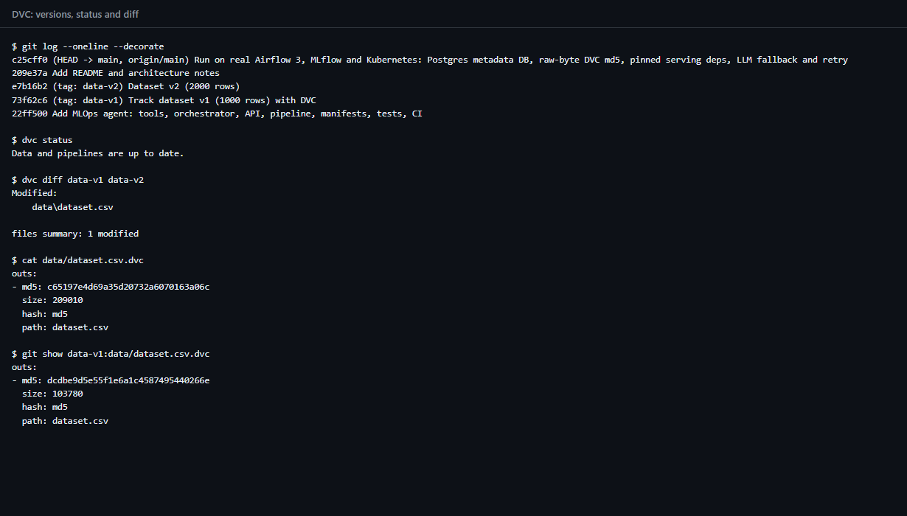

**MLflow** — runs produced by the Airflow DAG, each tagged with the DVC md5, the Git commit and the quality-gate result.

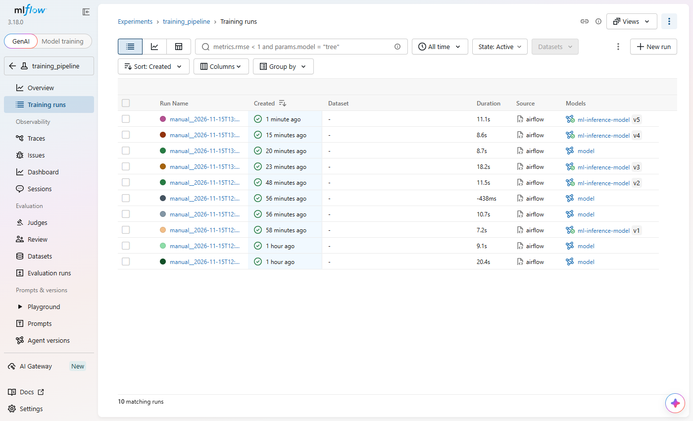
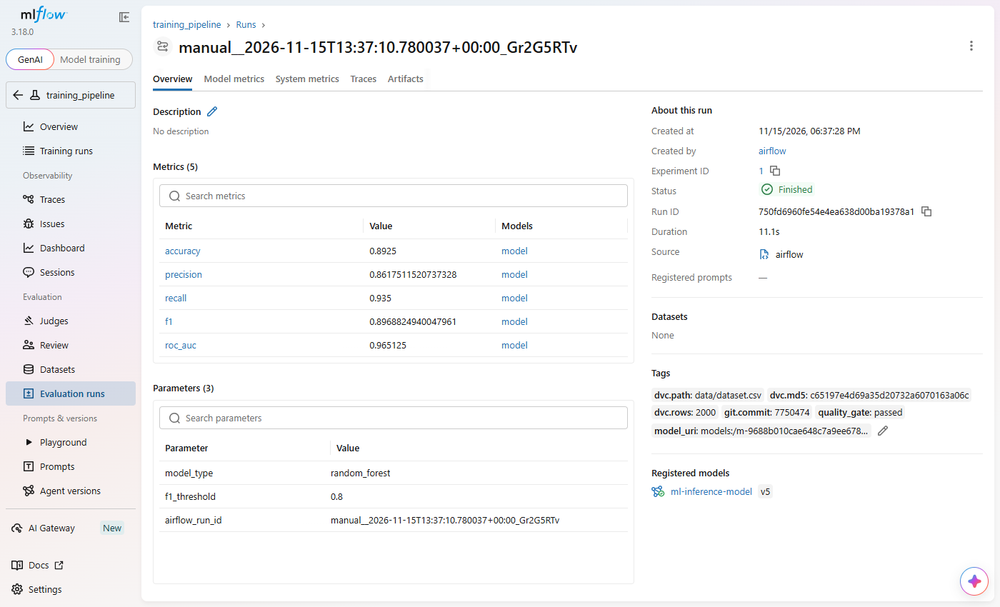
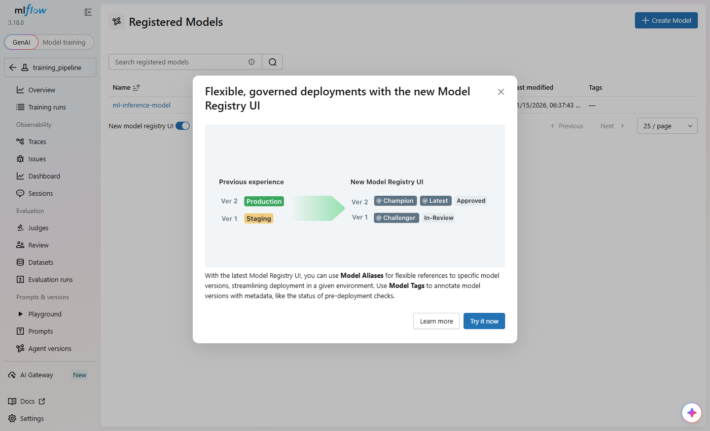

**Airflow 3** — the DAG `validate → preprocess → train → evaluate/log → quality gate`, real runs, a failed run's task log.

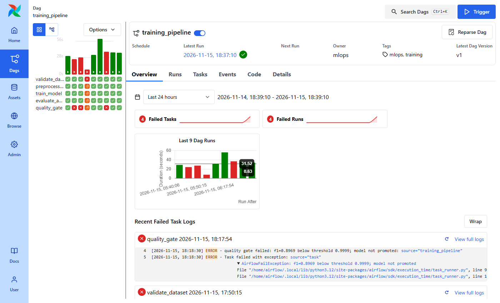
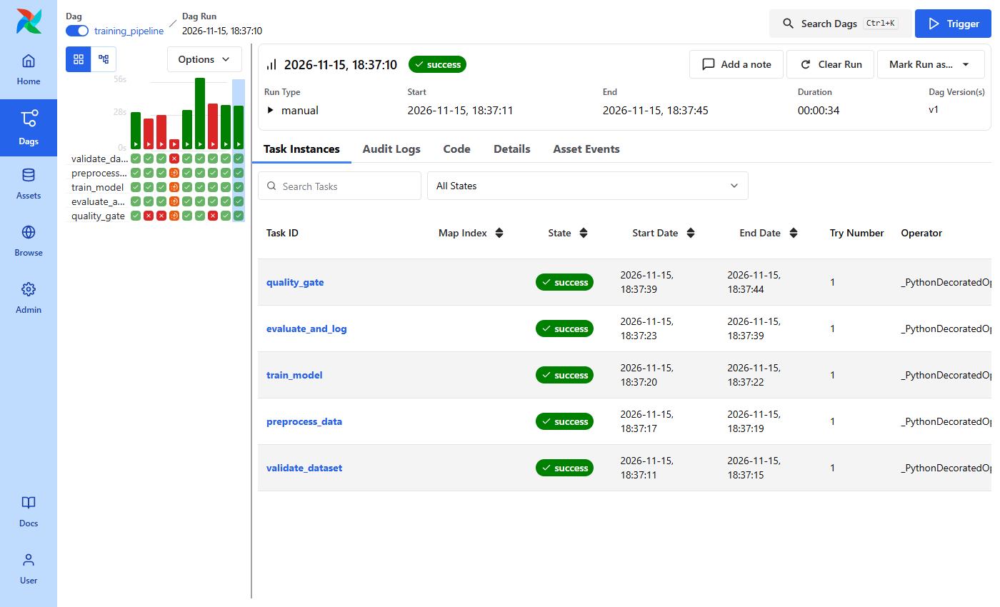
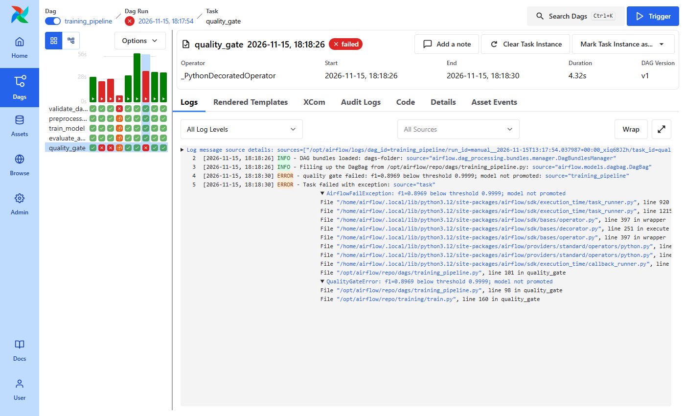

**Kubernetes** — the healthy deployment, then two injected faults.

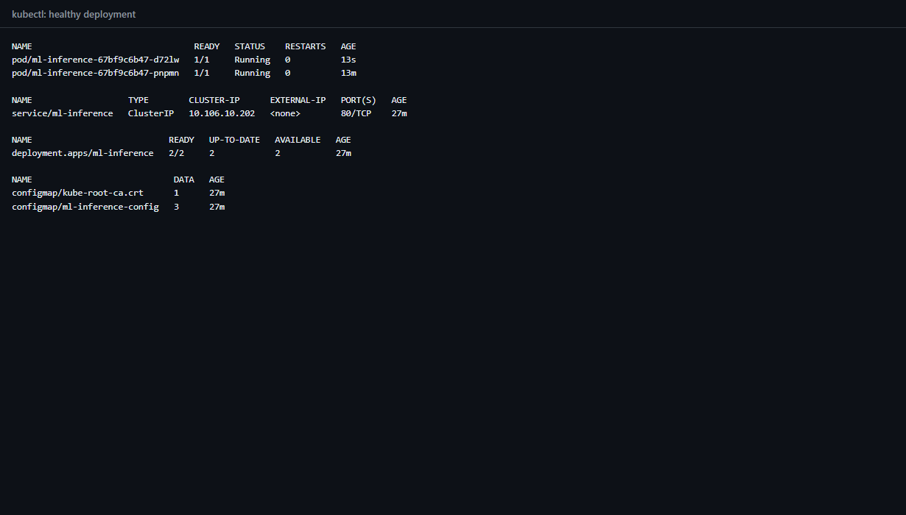
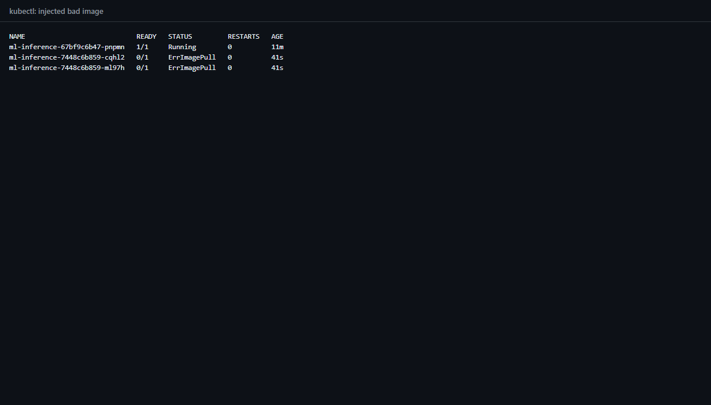
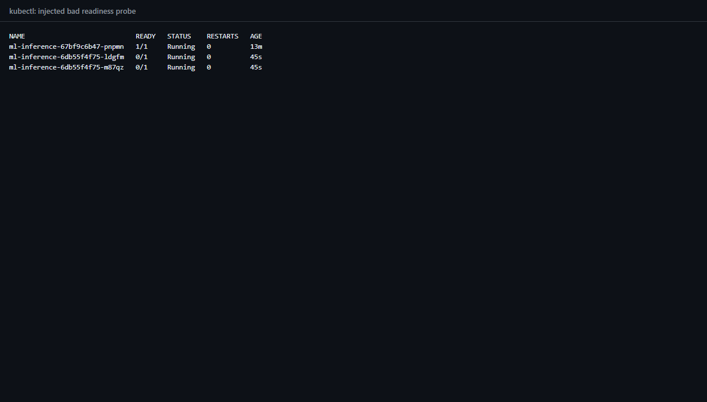

## 4. Five tested agent conversations (real tool evidence)

### 4.1 Dataset provenance

{{evidence:scenario_1_dataset_provenance.txt}}

### 4.2 Model selection

{{evidence:scenario_2_model_selection.txt|max=26}}

### 4.3 Pipeline execution (confirmation, then the real DAG run status)

{{evidence:scenario_3_pipeline_execution.txt|max=60}}

### 4.4 Deployment diagnosis

{{evidence:scenario_4_deployment_diagnosis.txt|max=34}}

### 4.5 Multi-tool reasoning (MLflow + DVC + Kubernetes + Airflow)

{{evidence:scenario_5_multi_tool_reasoning.txt}}

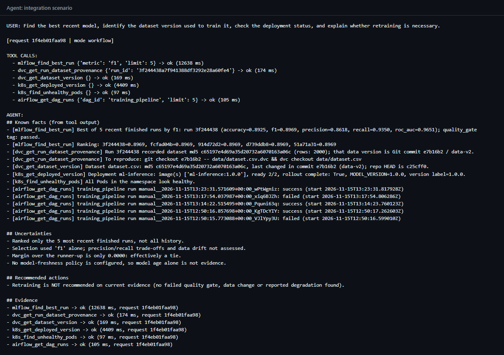

The agent separates known facts (tool output), uncertainties (tie between runs, single metric, no freshness
policy) and the recommendation. It did **not** recommend retraining because no failed gate, data change or
degradation report exists, and it never triggered the pipeline.

## 5. Failure investigations

### 5.1 Real failure: Kubernetes CrashLoopBackOff

*Symptom.* After `kubectl apply`, both Pods sat in `CrashLoopBackOff`, `0/2` ready. Asked "Why is my prediction
API unavailable?", the agent gathered Pod status, events, deployment, service and logs:

{{evidence:failure_k8s_crashloop.txt|max=34}}

*Root cause.* The model bundle was pickled inside the Airflow image, where numpy scalars are pickled through
`dill`. The serving image did not have `dill`, so `joblib.load` raised `ModuleNotFoundError: No module named 'dill'`
during startup and the container exited (readiness probe: connection refused).
*Resolution.* The serving image now pins the training environment: `scikit-learn==1.7.1`, `numpy==1.26.4`,
`joblib==1.5.1`, `dill==0.3.1.1` (`Dockerfile`). After a rollout restart both Pods are `1/1 Ready` and
`/predict` answers. *Lesson:* train and serve with identical library versions.

### 5.2 Injected failure: quality gate

Triggered the DAG with `{"f1_threshold": 0.9999}`. Everything up to evaluation succeeded; the gate blocked
promotion (run tagged `failed`, nothing registered or exported). The agent's diagnosis:

{{evidence:failure_airflow_quality_gate.txt|max=30}}

### 5.3 Further injected failures

* **Validation:** conf `{"inject_failure": "validation"}` — `validate_dataset=failed`, the other four tasks
  `upstream_failed`; agent output in `report/evidence/failure_airflow_validation.txt`.
* **Bad image tag** (`scripts/inject_k8s_failure.py bad-image`) — the agent reported `ImagePullBackOff`, the
  event `Failed to pull image "ml-inference:9.9.9"` and `1/2` ready (the old Pod kept serving):
  `report/evidence/failure_k8s_bad_image.txt`.
* **Bad readiness probe** (`bad-probe`) — Pods `Running` but never Ready, event `Readiness probe failed: HTTP probe
  failed with statuscode: 404`: `report/evidence/failure_k8s_bad_probe.txt`.

### 5.4 Unexpected failures found while building (and fixed)

| # | Symptom | Root cause | Fix |
|---|---|---|---|
| 1 | First real DAG run: `validate_dataset` failed, `dataset md5 8aa1… does not match DVC-recorded c651…` (found with `airflow_get_task_diagnostics`) | My md5 helper normalised CRLF line endings; DVC 3 (`hash: md5`) hashes the raw bytes | `dvc_md5` hashes raw bytes; regression test |
| 2 | `quality_gate` always `failed` in about 1 s with an empty task log | Airflow 3.0.6 + SQLite metadata DB race: `409 invalid_state … previous_state: scheduled`, executor `uhoh` (scheduler container log) | Postgres metadata DB in `docker-compose.yml` |
| 3 | Agent blamed the quality gate for a run that died at `validate_dataset` | The retraining rule counted `upstream_failed` tasks as failed | Only `state == failed` tasks count; regression test |
| 4 | Task diagnostics showed only `::group::` markers | Airflow 3 returns structured log events (`error_detail`), not strings | Parser extracts `exc_type: exc_value`; test |
| 5 | LLM sent `deployment='deployment', namespace='namespace'` for a restart | 1B model invents arguments | Mutating requests bypass LLM arguments; the namespace guard also rejected it |
| 6 | MLflow `git.commit: unknown` | The Airflow image has no `git` binary | Read `.git/HEAD` as fallback |

## 6. Testing

`pytest`: 76 automated tests, all external systems mocked (CI does not need Docker, a cluster or Ollama):
tool selection and execution with a scripted LLM; argument validation; timeouts; connection failures and
the retry rule; a test proving the agent invents nothing when every service is down; rejection of Kubernetes
changes without confirmation, in an unapproved namespace and with an LLM-injected confirmation flag; structured
log content and secret redaction; DVC tools against a real throw-away Git repo; end-to-end training runs against
a temporary MLflow store (gate pass registers and exports; gate failure registers nothing); the FastAPI interface.
GitHub Actions runs `ruff` and `pytest` on every pull request and push to `main`.

## 7. Known limitations and proposed improvements

* The 1B model cannot plan multi-tool chains or write faithful prose (its optional summary misstated correct
  evidence, so it is off by default). Improvement: a larger tool-capable model, or a structured-output planner.
* Deterministic runs give identical F1, so "best run" is a tie; a real comparison needs seeds, cross-validation
  and a held-out set, and the agent only ranks the last N runs.
* DVC remote is a local folder; use object storage for a team. The DVC md5 detection relies on `dvc status`.
* Airflow runs in standalone mode (one container, LocalExecutor); production would use separate components.
* Kubernetes single node; no HPA, ingress, NetworkPolicy or secrets manager; the demo model image is built locally.
* Confirmation state lives in process memory (pending actions are lost on restart; no expiry or per-user identity).
* No authentication on the agent API; it must sit behind an authenticating proxy.
* Task logs are only as informative as the DAG's own logging; scheduler-level faults (failure 2 above) are not
  visible through the task-log API, so the agent cannot diagnose them. Improvement: add a scheduler-log tool.
